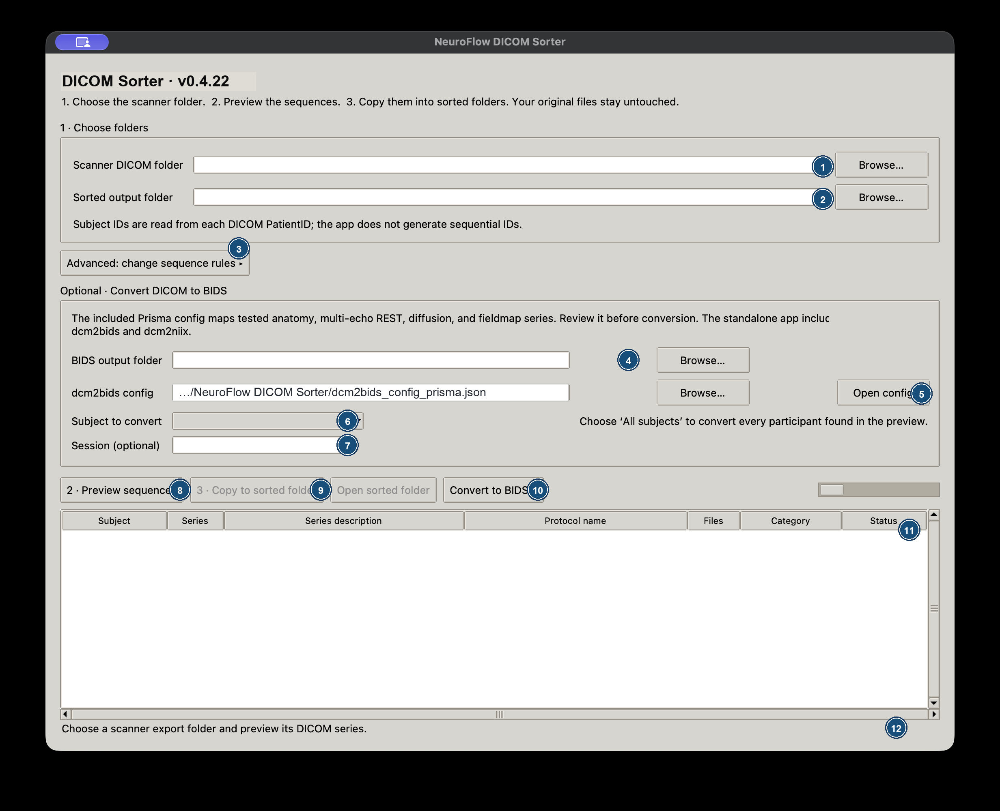

# NeuroFlow DICOM Sorter: Illustrated Workflow (English)

**App version:** 0.4.22
**Purpose:** Copy scanner DICOM files into one folder per detected subject and series. Optional BIDS conversion is included. The source export is never changed.



*Figure 1. Main controls. Callout numbers are explained in the table below. Example paths and participant labels are fictional.*

## What each control does

| No. | Control | What to do |
|---:|---|---|
| 1 | Scanner DICOM folder | Click **Browse…** and choose the scanner export folder. The app reads DICOM metadata and groups files by Study and Series Instance UID. |
| 2 | Sorted output folder | Choose where the copied series folders will go. The suggested folder ends in `_sorted`; use a new or empty folder outside the source. |
| 3 | Advanced: change sequence rules | Expand this section to choose the general rules, select the Prisma preset, browse to a rule file, or open the selected JSON for editing. |
| 4 | BIDS output folder | Choose a new or empty destination for NIfTI images and BIDS sidecars. This field is used only for conversion. |
| 5 | dcm2bids config / Open config | Browse to a different conversion config or open the currently selected JSON. Review it before converting. |
| 6 | Subject to convert | After preview, choose one detected `sub-…` ID or **All subjects**. “All subjects” converts every subject shown in the preview. |
| 7 | Session (optional) | Enter letters and numbers only (for example, `ses-01` is entered as `01`). Leave blank for a dataset without session labels. |
| 8 | 2 · Preview sequences | Scan and classify the source before copying. Status messages show progress while DICOM headers are read. |
| 9 | 3 · Copy to sorted folder | Copy the reviewed files into the output. This remains disabled until the preview is ready and any unmatched or ambiguous rows have been reviewed. |
| 10 | Convert to BIDS… | Start the optional dcm2bids + dcm2niix conversion for the chosen subject(s), after DICOM sorting. |
| 11 | Preview table | Check subject, series number, series description, protocol, file count, proposed category, and match status. Yellow rows need review; red rows match multiple rules. |
| 12 | Progress and status | Read scan, copy, and conversion updates here. A failed conversion message includes the app version and converter path to help identify which build was tested. |

## Before you begin

1. Copy the scanner export to a working folder. Keep the scanner’s original export intact.
2. Confirm that the export contains DICOM files. If it contains a `DICOMDIR`, keep it alongside its referenced files and select the folder that contains that index.
3. Download the package for your operating system. Confirm the version printed in the app title or window heading; this guide is for **0.4.22**.

### Install and open

- **Windows:** Run `NeuroFlowDICOMSorter-Windows-Setup-0.4.22.exe`. Launch the app from the Start menu or desktop shortcut.
- **macOS:** Unzip `NeuroFlowDICOMSorter-macOS-<architecture>-0.4.22.zip`, move `NeuroFlowDICOMSorter.app` to Applications, then open it. The internal academic build may not be notarized; if macOS blocks the first launch, use Finder’s Control-click → **Open**.

No Python, dcm2bids, or dcm2niix installation is required for the packaged app. Sorting works independently of BIDS conversion.

## Workflow A: sort the DICOM files

### 1. Select folders

Use callout **1** to select the scanner export. The app suggests a sibling output ending in `_sorted` (callout **2**). Check both paths before continuing:

- The sorted destination must be separate from the source.
- The destination must be new or empty; the app will not overwrite existing files.
- Subject IDs are read from the DICOM `PatientID` value. The app does not ask you to number subjects sequentially. It makes labels safe for BIDS folder names, such as `sub-20261016001`.

### 2. Select and review rules

The **general rules** preset recognizes common MRI naming patterns across vendors using `SeriesDescription`, `ProtocolName`, and other DICOM metadata. For a known Prisma protocol, open callout **3** and select the Prisma preset. Choose a custom JSON file if your scanner or protocol differs.

Click **Open rule file** to inspect or edit the active rules in a text editor. Save the file and click **Preview sequences** again to apply changes. A rule JSON supports regular expressions, `match_any` alternatives, and optional `exclude` patterns. Keep categories such as `anat`, `func`, `dwi`, `fmap`, and `physio` in line with your project conventions.

### 3. Preview every series

Click **2 · Preview sequences** (callout **8**) and wait for the status line (callout **12**) to report that the preview is complete. On large exports, the app first discovers files and then reads DICOM headers; it does not load the image pixel data for preview.

Review the table (callout **11**):

- **matched**: exactly one rule assigned a category.
- **unmatched**: no rule matched; the series is retained for review.
- **ambiguous**: more than one rule matched; the app does not guess between them.
- Siemens physiology recordings may appear as `PhysioLog` series. The general preset routes these to `physio`, excluding them from BOLD and DWI rules that also match their protocol names.

If a row is unexpected, open the rules, add a specific pattern or exclusion, save, and preview again. Do not copy an ambiguous or unmatched row into a modality folder without reviewing it. The review checkbox lets you proceed while keeping such series in review folders.

### 4. Copy into one folder per sequence

After reviewing the table, click **3 · Copy to sorted folder** (callout **9**) and confirm. If the app displays a review checkbox, check it only after you have inspected the rows. Original DICOM files stay where they are; sorting makes copies.

Example output:

```text
scanner-export_sorted/
└── sub-20261016001/
    ├── anat/series-6_3dT1w_mpr_sag_1mm/
    ├── func/series-18_mbep2d_bold_REST1/
    ├── dwi/series-42_diff_dir98_AP/
    ├── physio/series-19_bold_REST1_PhysioLog/
    └── _unmatched/series-3_SequenceToReview/
```

Each leaf folder contains the DICOM instances for one series. Click **Open sorted folder** to inspect the result in Finder or File Explorer.

## Workflow B: convert sorted DICOM to BIDS (optional)

The app includes dcm2bids and dcm2niix. Conversion reads from the sorted copy; it does not alter the scanner export. Convert after reviewing and sorting.

1. Select the **BIDS output folder** (callout **4**). Use a new or empty destination; existing output is not overwritten.
2. Review the selected JSON through **Open config** (callout **5**). The included config is designed around the Prisma sequences observed in the project test data. For another protocol, edit or browse to a suitable config.
3. In **Subject to convert** (callout **6**), choose a detected subject or **All subjects**. The app converts selected subjects sequentially into the same BIDS dataset.
4. Optionally type a session label in callout **7**, using letters and digits only. Leave it blank when no session is needed.
5. Click **Convert to BIDS…** (callout **10**) and confirm. Follow progress at callout **12**. Keep the app open until it reports completion or an error.
6. Inspect the NIfTI images and JSON sidecars. Run a BIDS validator before downstream analysis.

A successful exit does not replace scientific review of image selection or metadata. Verify that the intended normalized structural image was selected and inspect phase-encoding, readout-time, and diffusion metadata before preprocessing.

## Troubleshooting

### Preview appears to pause

Watch the status line. It reports discovery and header-read progress. Very large folders take longer. Keep prior outputs (`*_sorted`, `*_BIDS`, or `dcm2bids_intermediates`) outside the source folder to avoid scanning them as if they were scanner data.

### A series is unmatched or assigned to the wrong category

Check the series description and protocol shown in the table. Open the active rule JSON and add a scanner-specific pattern or exclusion; then run preview again. Keep uncertain sequences in the review area rather than guessing.

### `PhysioLog` appears as BOLD, DWI, or ambiguous

Use the **general rules** preset from version 0.4.22 or newer. It excludes physiology and PMU descriptions from image-sequence rules and gives them a dedicated physiology rule. Review with a small preview before copying.

### Windows reports `dcm2bids` could not parse its arguments

Confirm the installed app shows **v0.4.22** in its title. The versioned Windows build starts the bundled converter as an independent process, including when the installation path contains spaces. Reinstall the matching versioned package; older installers do not receive source changes automatically. If the updated app still fails, record the full error including app version and converter path.

### A mapping reports “No BIDS files found”

That mapping did not match a converted dcm2niix sidecar. Open the config and compare its criteria with the sidecar metadata produced from the selected series. Correct the rule and retry in a new empty BIDS output folder; inspect any partial output before removing it.

### Conversion stops before all subjects finish

The message indicates how many subjects completed and where partial output may exist. Review the completed subjects and the error before continuing. Use a new empty output destination for a clean retry rather than mixing partial and new output.

## Data handling

The app copies DICOM files and retains the source folder. Output paths may contain sensitive participant information; store and share them according to your institution’s data rules. The manual screenshot and sample labels use fictitious paths and IDs.
