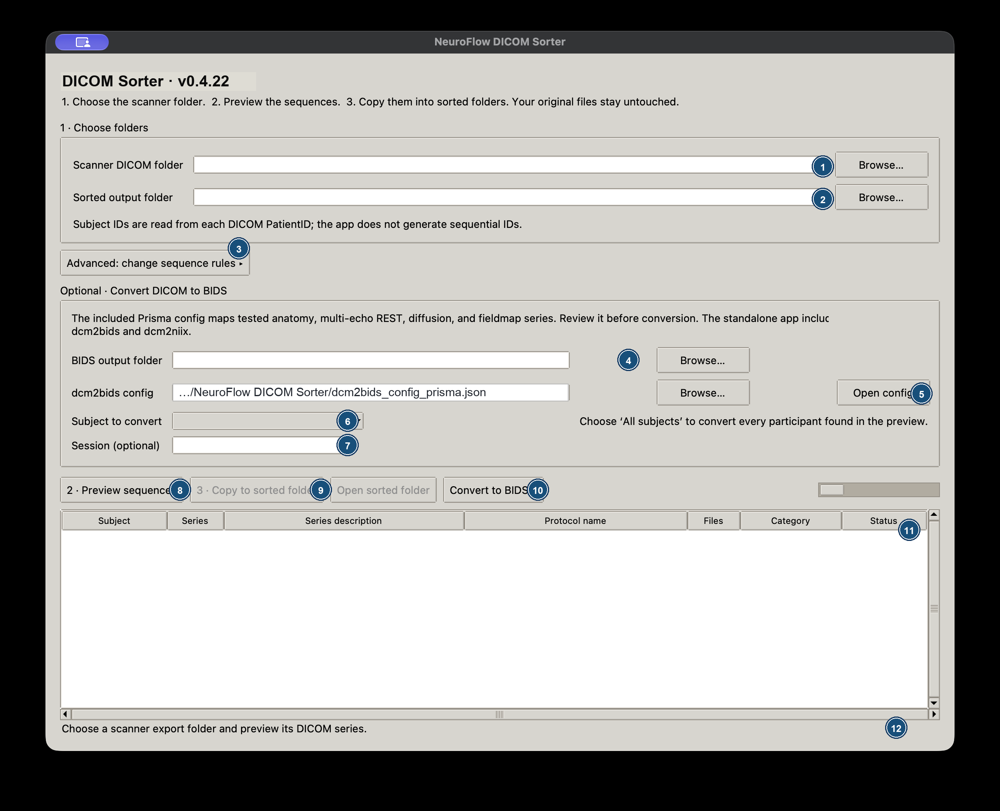

# NeuroFlow DICOM Sorter：图示操作手册（简体中文）

**应用版本：**0.4.22
**用途：**将扫描仪导出的 DICOM 文件复制整理为“每位受试者、每个序列一个文件夹”。应用还提供可选的 BIDS 转换功能。原始导出文件不会被修改。



*图 1. 主界面控件。下表说明各编号。示例路径和受试者标签均为虚构内容。*

## 界面控件说明

| 编号 | 控件 | 操作说明 |
|---:|---|---|
| 1 | Scanner DICOM folder（扫描仪 DICOM 文件夹） | 点击 **Browse…** 选择扫描仪导出目录。应用读取 DICOM 元数据，按 Study 和 Series Instance UID 分组。 |
| 2 | Sorted output folder（分类输出目录） | 选择复制后的序列文件夹保存位置。默认目录名以 `_sorted` 结尾；请选择源目录之外的新建或空目录。 |
| 3 | Advanced: change sequence rules（高级：修改序列规则） | 展开后可使用通用规则、Prisma 预设、浏览规则文件或打开 JSON 文件编辑。 |
| 4 | BIDS output folder（BIDS 输出目录） | 选择保存 NIfTI 图像和 BIDS sidecar 的新建或空目录。仅转换时使用。 |
| 5 | dcm2bids config / Open config（转换配置 / 打开配置） | 可选择其他配置文件，或打开当前 JSON 检查。转换前应核对配置。 |
| 6 | Subject to convert（待转换受试者） | 预览后选择一个识别到的 `sub-…` 标签，或选择 **All subjects** 转换预览中的全部受试者。 |
| 7 | Session (optional)（会话，可选） | 仅输入英文字母和数字，例如输入 `01` 表示 `ses-01`。无需会话标签时留空。 |
| 8 | 2 · Preview sequences（预览序列） | 扫描并分类源目录；复制前先检查预览。读取 DICOM header 时状态栏会显示进度。 |
| 9 | 3 · Copy to sorted folder（复制到分类目录） | 将已核对的文件复制到输出目录。预览完成且未匹配或多义匹配的序列已检查后才会启用。 |
| 10 | Convert to BIDS…（转换为 BIDS） | 在先完成 DICOM 分类后，针对选定受试者启动可选 dcm2bids + dcm2niix 转换。 |
| 11 | 预览表格 | 核对受试者、序列号、序列描述、协议、文件数、建议类别和匹配状态。黄色行需检查；红色行表示匹配了多条规则。 |
| 12 | 进度和状态 | 查看扫描、复制和转换的进度。转换失败信息会显示应用版本和转换器路径，便于确认所测版本。 |

## 开始前

1. 将扫描仪导出数据复制到工作目录，并保留扫描仪原始导出文件。
2. 确认目录中有 DICOM 文件。如果含有 `DICOMDIR`，请保留该索引及其引用的文件，并选择包含索引的目录。
3. 下载对应操作系统的安装包。检查应用标题栏或窗口标题显示的版本；本手册对应 **0.4.22**。

### 安装并启动

- **Windows：**运行 `NeuroFlowDICOMSorter-Windows-Setup-0.4.22.exe`，然后从“开始”菜单或桌面快捷方式启动应用。
- **macOS：**解压 `NeuroFlowDICOMSorter-macOS-<架构>-0.4.22.zip`，将 `NeuroFlowDICOMSorter.app` 移入“应用程序”，然后打开。内部学术测试版可能未经公证；若 macOS 首次阻止启动，可在 Finder 中按住 Control 键点击应用，再选择“打开”。

打包版无需另行安装 Python、dcm2bids 或 dcm2niix。DICOM 分类不依赖 BIDS 转换工具。

## 流程 A：整理 DICOM 文件

### 1. 选择输入和输出目录

使用编号 **1** 选择扫描仪导出目录。应用会建议一个同级的 `_sorted` 输出目录（编号 **2**）。开始前核对路径：

- 分类输出目录必须与源目录分开。
- 输出目录必须是新建或空目录；应用不会覆盖已有文件。
- 受试者 ID 读取自 DICOM 的 `PatientID`。应用不要求用户按顺序编号；它会将标签清理为适用于 BIDS 目录名的字符，例如 `sub-20261016001`。

### 2. 选择并核对序列规则

**通用规则**预设使用 `SeriesDescription`、`ProtocolName` 和其他 DICOM 元数据，识别多厂家常见 MRI 序列。对于已知的 Prisma 协议，展开编号 **3** 并选择 Prisma 预设。扫描仪或协议不同，也可以选择自定义 JSON 文件。

点击 **Open rule file（打开规则文件）**，在文本编辑器中检查或修改当前规则。保存后重新点击 **Preview sequences（预览序列）**使修改生效。规则 JSON 支持正则表达式、`match_any` 多条件选项以及可选的 `exclude` 排除模式。请按项目约定使用 `anat`、`func`、`dwi`、`fmap` 和 `physio` 等类别。

### 3. 预览全部序列

点击 **2 · Preview sequences**（编号 **8**），等待状态栏（编号 **12**）提示预览完成。对于较大的导出目录，应用先查找文件，再读取 DICOM header；预览阶段不会读取图像像素数据。

请检查表格（编号 **11**）：

- **matched（已匹配）**：恰好有一条规则指定了类别。
- **unmatched（未匹配）**：没有规则匹配；序列保留待检查。
- **ambiguous（多义匹配）**：同时匹配多条规则；应用不会自行猜测。
- Siemens 生理记录可能显示为 `PhysioLog`。通用预设会将它们归入 `physio`，并排除出那些仅因协议名称包含 BOLD 或 DWI 而被匹配的图像规则。

如果分类不符合预期，打开规则文件添加更具体的匹配模式或排除条件，保存并重新预览。不要未经检查就将多义或未匹配的序列放入模态文件夹。核对后勾选 review checkbox，应用会把这类文件留在待检查文件夹中并允许复制。

### 4. 复制为每序列一个文件夹

确认表格后，点击 **3 · Copy to sorted folder**（编号 **9**）并确认。如果显示 review checkbox，请先检查有关序列再勾选。应用复制文件，原始 DICOM 仍保留在原位置。

输出示例：

```text
scanner-export_sorted/
└── sub-20261016001/
    ├── anat/series-6_3dT1w_mpr_sag_1mm/
    ├── func/series-18_mbep2d_bold_REST1/
    ├── dwi/series-42_diff_dir98_AP/
    ├── physio/series-19_bold_REST1_PhysioLog/
    └── _unmatched/series-3_SequenceToReview/
```

每个最末级目录包含一个序列的 DICOM 实例。复制完成后点击 **Open sorted folder（打开分类目录）**，在 Finder 或文件资源管理器中检查结果。

## 流程 B：将分类后的 DICOM 转换为 BIDS（可选）

应用已打包 dcm2bids 和 dcm2niix。转换读取分类后的副本，不会修改扫描仪导出数据。请先完成检查和分类，再开始转换。

1. 选择 **BIDS output folder**（编号 **4**）。请选择新建或空目录；应用不会覆盖已有输出。
2. 点击 **Open config**（编号 **5**）检查当前 JSON。随附配置依据项目测试数据中观察到的 Prisma 序列编写。其他协议应编辑或选择合适配置。
3. 在 **Subject to convert**（编号 **6**）中选择一个受试者或 **All subjects**。应用会逐个转换选中的受试者，并写入同一个 BIDS 数据集。
4. 可在编号 **7** 输入会话标签，仅使用英文字母和数字。不需要会话时留空。
5. 点击 **Convert to BIDS…**（编号 **10**）并确认。通过编号 **12**查看进度。完成或出现错误前请保持应用开启。
6. 检查 NIfTI 图像和 JSON sidecar。在后续分析前运行 BIDS Validator。

转换正常退出仍不能替代影像和元数据的科学核查。请确认选择了预期的 normalized 结构像，并检查相位编码方向、读出时间和扩散元数据，再进入预处理。

## 常见问题

### 预览似乎停住

观察状态栏是否显示进度。应用会报告文件发现和 DICOM header 读取进度；很大的目录需要更多时间。请将之前生成的 `*_sorted`、`*_BIDS` 或 `dcm2bids_intermediates` 输出放在源目录之外，避免被当作扫描仪数据重新扫描。

### 序列未匹配或类别不正确

检查表格显示的序列描述和协议。打开当前规则 JSON 添加适合本扫描仪的模式或排除条件，然后重新预览。无法确定时，请保留在待检查目录，不要猜测分类。

### `PhysioLog` 被识别为 BOLD、DWI 或多义匹配

使用 0.4.22 或更新版本的**通用规则**预设。该版本会从图像序列规则中排除生理记录和 PMU 描述，并为生理记录设置独立规则。复制前先查看预览结果。

### Windows 提示 `dcm2bids` 无法解析参数

确认应用标题栏显示 **v0.4.22**。该版本 Windows 打包会以独立进程启动内置转换器，即使安装路径中有空格也适用。请重新安装相同版本的安装包；只更新源码不会自动更新已安装应用。如果仍失败，请记录完整错误，尤其是应用版本和转换器路径。

### 提示 “No BIDS files found”

表示该映射条件没有匹配到 dcm2niix 生成的 sidecar。打开配置，将匹配条件与目标序列转换出的 sidecar 元数据比较。修改规则后，使用新的空 BIDS 输出目录重试；如存在部分输出，请先检查。

### 多个受试者转换尚未完成就停止

错误信息会说明已完成的受试者数和部分结果所在目录。请检查已完成部分和报错内容。重新转换时使用新的空输出目录，避免将部分结果和新结果混在一起。

## 数据处理说明

应用复制 DICOM 文件并保留源目录。输出路径可能包含敏感受试者信息，请按照机构数据管理要求保存和共享。手册截图中的路径和 ID 均为虚构内容。
