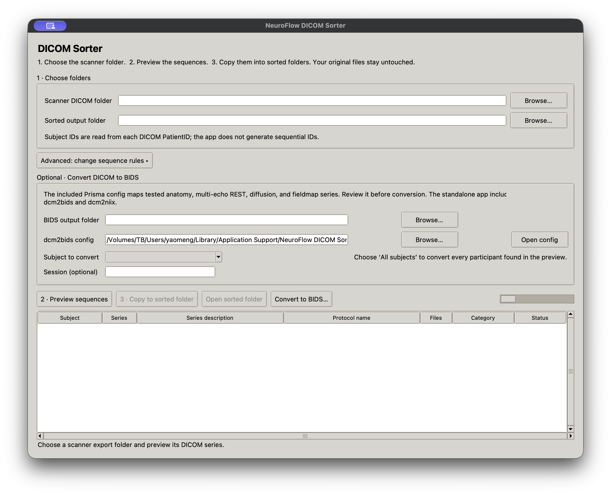

# NeuroFlow DICOM Sorter：示例工作流程（简体中文）

本手册演示从扫描仪导出文件到序列分类及可选 BIDS 转换的常见流程。截图展示应用界面。下文中的 `DEMO001` 为虚构示例标签，不涉及真实受试者数据。

## 1. 安装并启动

- **Windows：**运行下载的 `NeuroFlowDICOMSorter-Windows-Setup-0.4.16.exe` 安装程序，然后从“开始”菜单或桌面快捷方式启动 NeuroFlow DICOM Sorter。
- **macOS：**解压 `NeuroFlowDICOMSorter-macOS-…-0.4.16.zip`，将应用拖入“应用程序”文件夹后打开。此内部测试原型尚未进行公证；如果 macOS 首次阻止启动，请在 Finder 中按住 Control 键点击应用，再选择“打开”。

打包应用无需单独安装 Python、dcm2bids 或 dcm2niix。DICOM 分类功能不依赖 BIDS 转换工具。

## 2. 选择扫描仪导出文件夹

在 **Scanner DICOM folder（扫描仪 DICOM 文件夹）**中选择复制出的 DICOM 文件所在文件夹。应用读取 DICOM 元数据，并按 Study Instance UID 和 Series Instance UID 对图像实例分组。受试者标签取自 DICOM `PatientID`，应用不会自行生成连续编号。

应用会在源文件夹旁建议一个独立的 `_sorted` 输出目录。可以修改路径，但目标目录必须是新建或空文件夹。分类过程会复制文件，不会修改原始扫描仪导出数据。



## 3. 预览并核对序列

点击 **2 · Preview sequences（预览序列）**。复制前请核对受试者、序列描述、协议名称、建议类别和状态。通用规则预设覆盖常见 MRI 序列名称。若数据来自本项目使用的 Prisma 协议，展开 **Advanced: change sequence rules（高级：修改序列规则）**，点击 **Use Prisma preset（使用 Prisma 预设）**。也可打开并编辑 JSON 规则，或选择自定义规则文件。

没有匹配规则的序列标记为 **unmatched（未匹配）**；同时匹配多条规则的序列标记为 **ambiguous（多义匹配）**。这些序列会保留在预览表中，必须勾选“已检查未匹配或多义序列”后才能开始复制。若分类不正确，可修改规则后重新预览，或让该序列保留在待检查目录中。

## 4. 复制并整理序列

确认预览内容后，点击 **3 · Copy to sorted folder（复制到分类目录）**并确认。每个序列会单独复制到对应类别文件夹，例如：

```text
scanner-export_sorted/
└── sub-DEMO001/
    ├── anat/series-1_T1w_MPRAGE/
    ├── func/series-2_task-rest_bold/
    └── _unmatched/series-3_SequenceDelta/
```

未匹配示例会单独保留，供人工归类。复制完成后点击 **Open sorted folder（打开分类目录）**查看结果。

## 5. 可选：转换为 BIDS

BIDS 转换是单独的可选步骤，应用已打包 dcm2bids 和 dcm2niix。

1. 先完成 DICOM 分类。
2. 在 **Subject to convert（待转换受试者）**中选择一个受试者，或选择 **All subjects（全部受试者）**。
3. 选择一个新建或空的 **BIDS output folder（BIDS 输出目录）**。
4. 点击 **Open config（打开配置）**检查 dcm2bids JSON 配置。随附配置针对已观察到的 Prisma 序列；其他协议请先调整配置。
5. 可选填 **Session（会话）**标签，然后点击 **Convert to BIDS…（转换为 BIDS）**并确认。

应用按受试者逐一转换，并保留原始 DICOM。请检查生成的 NIfTI 文件和 JSON sidecar，并在后续分析前运行 BIDS Validator。不要仅凭序列名称推断相位编码方向、读出时间或扩散成像元数据。

## 常见问题

- **预览需要等待：**状态栏会显示文件发现和读取进度。条件允许时，请勿将已生成的 `_sorted` 或 `_BIDS` 目录放在原始扫描仪文件夹内。
- **序列类别不符合预期：**根据预览中的状态和序列描述核对规则匹配情况，编辑 JSON 规则后重新预览。
- **提示某个 mapping 没有 BIDS 文件：**表示该 dcm2bids 配置条目未匹配到转换后的 sidecar。请检查配置和 dcm2niix 生成的 JSON sidecar，修正映射后再使用新的空输出目录重试。
- **转换中途停止：**先检查提示中所述的部分 BIDS 输出；重试时使用新的空目录，避免混合不完整结果。
